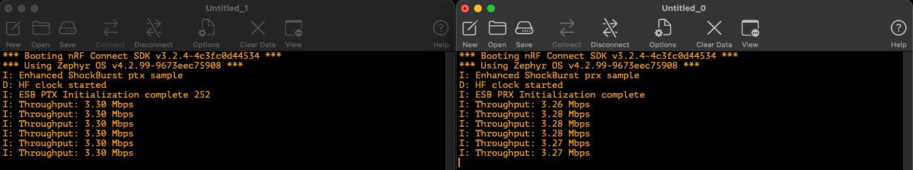

# ESB 4 Mbps Throughput Demo for BL54L15

Demonstrates high-throughput wireless communication using Nordic's [Enhanced Shockburst (ESB)](https://docs.nordicsemi.com/bundle/ncs-latest/page/nrf/protocols/esb/index.html) protocol with the proprietary 4 Mbps PHY on the nRF54 series, targeting the [Ezurio BL54L15 DVK](https://www.ezurio.com/product/bl54l15-series-bluetooth-le-80215-4-nfc).

Achieves ~3.3 Mbps sustained unidirectional throughput -- exceeding what is possible with Bluetooth Low Energy's 2 Mbps PHY.

## Projects

| Project | Role | Description |
|---|---|---|
| `esb_4mbps_ptx` | Transmitter (PTX) | Continuously sends 252-byte payloads at maximum rate |
| `esb_4mbps_prx` | Receiver (PRX) | Receives packets and reports throughput |

## Requirements

- 2x Ezurio BL54L15 DVK
- nRF Connect SDK v3.2.4
- VS Code with the nRF Connect for VS Code extension

For setup instructions, see the Ezurio [Quick Start Guide -- BL54Lxx Series Application Development with Nordic nRF Connect for VS Code](https://www.ezurio.com/documentation/quick-start-guide-bl54lxx-series-application-development-with-nordic-nrf-connect-for-vs-code).

## Key Configuration

The following changes over the default ESB samples enable 4 Mbps throughput:

- `ESB_BITRATE_4MBPS` -- selects the 4 Mbps PHY
- `CONFIG_ESB_MAX_PAYLOAD_LENGTH=252` -- maximum payload size per packet
- `selective_auto_ack = true` / `tx_payload.noack = true` -- disables per-packet acknowledgement
- `CONFIG_ESB_FAST_SWITCHING=y` -- reduces radio ramp-up time
- Tight `k_yield()` TX loop instead of `k_sleep()` for continuous transmission

## Documentation

See [(add link to the final application note)]() for a detailed write-up including an ESB protocol overview, code walkthrough, throughput calculations, and known limitations.

## License

Based on ESB sample applications from the nRF Connect SDK, licensed under the [Nordic 5-Clause License](https://github.com/nrfconnect/sdk-nrf/blob/main/LICENSE).
